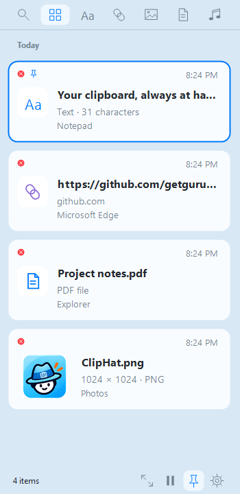

# ClipHat for Windows

**Your clipboard, always at hand.**

ClipHat is a native Windows clipboard history app from GuruHat. It stores copied text, links, images, and files locally so you can find and restore them later. It runs in the notification area and opens with **Ctrl+Shift+V**.

## Install the latest build

Download the ready-to-install package: [ClipHat-1.5.2-Windows-Setup.exe](https://github.com/getguruhat/cliphat-windows/releases/download/v1.5.2-windows/ClipHat-1.5.2-Windows-Setup.exe).

Run the installer on Windows 10 (version 1903 or later) or Windows 11 (x64), then launch ClipHat. ClipHat uses the .NET Framework 4.8 that comes with Windows; on an older Windows 10 build without it, the installer links to Microsoft's download. Windows may show a SmartScreen warning because this community build is not code signed.

When upgrading, quit ClipHat from its notification-area menu, run the new installer, and launch it again. The sliding panel has no Windows title bar. Settings displays the installed version.

## Windows panel



## Use

- Copy text, links, images, or a regular file, then press **Ctrl+Shift+V** to slide history in from the side of the active screen. Choose the left or right edge in Settings.
- Use the icon row to search or filter by type. Rounded white cards show previews, source apps, and copy times.
- Use the bottom toolbar to enlarge image/file previews, pause capture, keep the panel open with the thumbtack, or open Settings. A blue thumbtack keeps the panel visible while working in other apps; click it again to restore auto-close. **Esc** and **Ctrl+Shift+V** still close the panel.
- Drag cards into another app to transfer text or real image/file copies.
- Use **Up/Down** to select a card, **Enter** to copy, **Ctrl+F** to search, and **Ctrl+Delete** to delete.
- Search or filter by type, and click an item or press **Enter** to put it back on the clipboard. Press **Ctrl+V** in the target app to paste.
- Right-click a card to copy, pin/unpin an item, delete it, or open a link. Item pins protect entries from retention; the toolbar thumbtack controls whether the panel stays open. The red × on each card deletes that entry.
- Settings uses General, History, Privacy, and About tabs, matching the macOS layout. Configure startup, previews, retention, and ignored applications; the About tab displays the ClipHat app icon.

ClipHat follows your Windows display language in English, Spanish, German, French, Italian, Portuguese, Japanese, Simplified Chinese, and Korean (the text is in `Strings.cs`), and uses English for any other language.

ClipHat stores history in `%LOCALAPPDATA%\GuruHat\ClipHat`. There are no accounts, cloud services, analytics, or network calls. Text is limited to 1 MB, images to 10 MB, and individual files to 20 MB. Copied folders are skipped.

## Build

The source is a Windows Forms project that targets .NET Framework 4.8, which comes with Windows 10 and 11, so the build is a small folder (`ClipHat.exe`, its `.config`, and the System.Text.Json DLLs) rather than a self-contained runtime. To build on your own PC you need the .NET 8 SDK (only as the compiler):

```powershell
dotnet publish ClipHat.csproj -c Release -o publish
publish\ClipHat.exe --smoke-test   # checks the panel and saves screenshots to screenshots\
```

GitHub Actions builds it on every push, packages it with Inno Setup, and attaches the installer to the Windows release for the version in `ClipHat.csproj` (with the notes in `RELEASE_NOTES.md`).

### Microsoft Store (MSIX)

The same build also makes `ClipHat-<version>-x64.msix` (the **ClipHat-Windows-msix** artifact) from `msix/AppxManifest.xml`, then test-installs it on the runner. Upload that file to Partner Center as is: the Store signs it when it publishes. The `Identity` and `PublisherDisplayName` in the manifest must match Partner Center's **Product identity** page. In the packaged app, **Launch ClipHat at login** uses the package's startup task instead of the registry, files you paste or drag out are copied to the package's temp folder, and Windows removes ClipHat's history when it's uninstalled.

## Other platforms

ClipHat for macOS is a separate native app. Download it from the [ClipHat for macOS releases](https://github.com/getguruhat/cliphat-macos/releases/latest).
